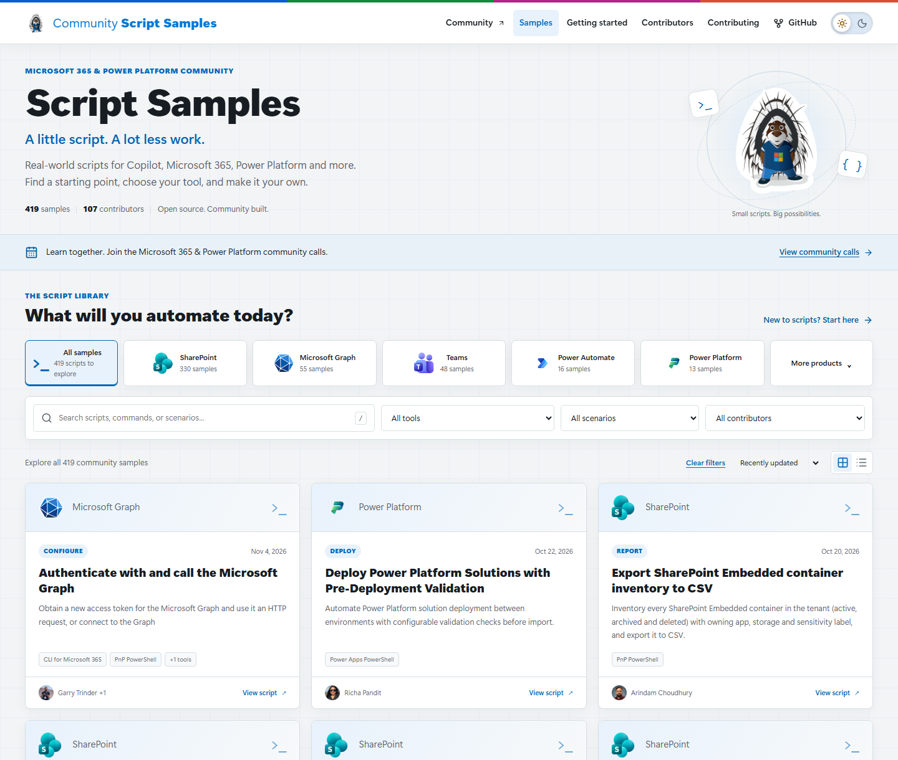
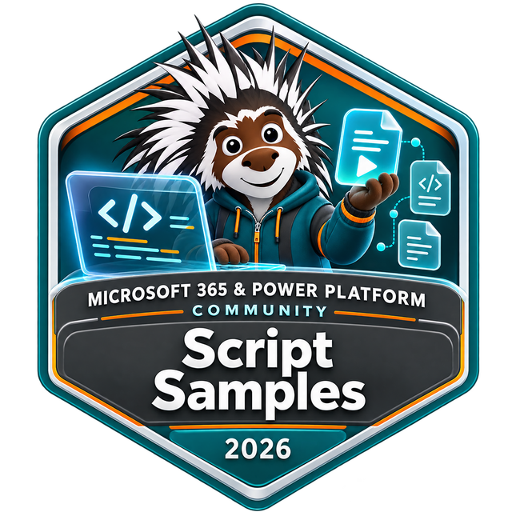

# Community Script Samples

[](https://pnp.github.io/script-samples/)

**[Browse the script gallery](https://pnp.github.io/script-samples/)** | [Get started](docs/getting-started.md) | [Share a sample](docs/contributing/preparing-a-submission.md)

*Gallery preview. The published site updates after this change is reviewed, merged, and deployed.*

A little script. A lot less work. Explore 400+ real-world scripts for Copilot, Microsoft 365, Power Platform and more, shared by the community. Find a starting point, choose your tool, and make it your own.

Find scripts for SharePoint, Microsoft Graph, Teams, Microsoft Copilot, Power Platform, Azure, and more. Choose the tools you already use: PnP PowerShell, CLI for Microsoft 365, Microsoft Graph PowerShell, SharePoint Online Management Shell, Azure CLI, and others.

## Find your next starting point

1. **Find a task:** search the [gallery](https://pnp.github.io/script-samples/) for a scenario or command, or browse by product or tool.
2. **Choose an implementation:** many samples offer more than one tool. Read the README and select the matching code tab.
3. **Review, adapt, and test:** check prerequisites and permissions, replace placeholders, and test safely before using production data. Samples can modify or remove tenant data.

The scripts and their documentation live together under [scripts/](scripts/). No need to install or build the gallery to use or contribute a sample.

## Your everyday script could make someone's day

New contributors are welcome. Share a useful scenario, add another tool to an existing sample, fix a bug, or improve the guidance. A focused contribution does not have to be a large one.

The [New-Sample.ps1 generator](New-Sample.ps1) creates a sample folder, README, metadata, tool tabs, and placeholder images. Run it from the cloned repository root in PowerShell 7, using your own name and GitHub handle:

```powershell
.\New-Sample.ps1 -ScriptFolderName "spo-get-site-report" `
    -ScriptTitle "Report SharePoint sites" `
    -ScriptShortDescription "Export a SharePoint site inventory." `
    -ScriptTool PnPPowerShell `
    -AuthorFullName "Your name" `
    -GitHubId "your-github-handle"
```

Replace the generated script placeholder, finish the metadata, and add your preview. The [step-by-step contribution guide](docs/contributing/preparing-a-submission.md) explains what the generator does and what to finish before opening a pull request.

Not ready to write a sample? [Report an issue](https://github.com/pnp/script-samples/issues/new), suggest a scenario, or help test an existing script. New to GitHub? [Sharing is caring](https://pnp.github.io/sharing-is-caring/) offers friendly, hands-on sessions.

## Earn your Script Samples contributor badge

[](https://pnp.github.io/recognitionprogram/)

Every sample contributor is eligible, including first-time contributors. After your first accepted sample, [opt in to the community recognition program](https://pnp.github.io/recognitionprogram/) to receive your badge. Issuance is processed in batches, so it is not immediate.

Your contribution is credited in the sample. Share its gallery link with your team or community, and [request a community demo slot](https://aka.ms/community/request/demo) to show what you learned. See [contributor recognition](docs/contributing/recognition.md) for details.

## Learn and share with the community

- [Join the Microsoft 365 & Power Platform community](https://aka.ms/community/home).
- [View community calls and download recurring invites](https://aka.ms/community/calls). Everyone is welcome to learn, ask questions, and share ideas.
- [Explore ways to contribute](docs/contributing/how-can-i-contribute.md) or [help maintain the gallery](docs/contributing/maintainers-guidance.md).
- When sharing a sample, link to its gallery page, credit its authors, and explain the scenario it helped you solve. Remove tenant or personal information from screenshots.

This is an open-source community project maintained by volunteers. Thank you to everyone who shares code, reports issues, and helps others get started.

## Work on the gallery

The site uses Astro and TypeScript. With Node.js 22.19 or later, run `npm --prefix site ci`, then `npm --prefix site run dev` and open `http://localhost:4321/script-samples/`.

[Local development, validation, and deployment](docs/contributing/maintainers-guidance.md) | [Migration and GitHub Pages cutover notes](site/MIGRATION.md)

## Code of Conduct

This repository has adopted the [Microsoft Open Source Code of Conduct](https://opensource.microsoft.com/codeofconduct/). For more information see the [Code of Conduct FAQ](https://opensource.microsoft.com/codeofconduct/faq/) or contact [opencode@microsoft.com](mailto:opencode@microsoft.com) with any additional questions or comments.

## Disclaimer

**THESE SAMPLES ARE PROVIDED *AS IS* WITHOUT WARRANTY OF ANY KIND, EITHER EXPRESS OR IMPLIED, INCLUDING ANY IMPLIED WARRANTIES OF FITNESS FOR A PARTICULAR PURPOSE, MERCHANTABILITY, OR NON-INFRINGEMENT.**

> Sharing is caring!


