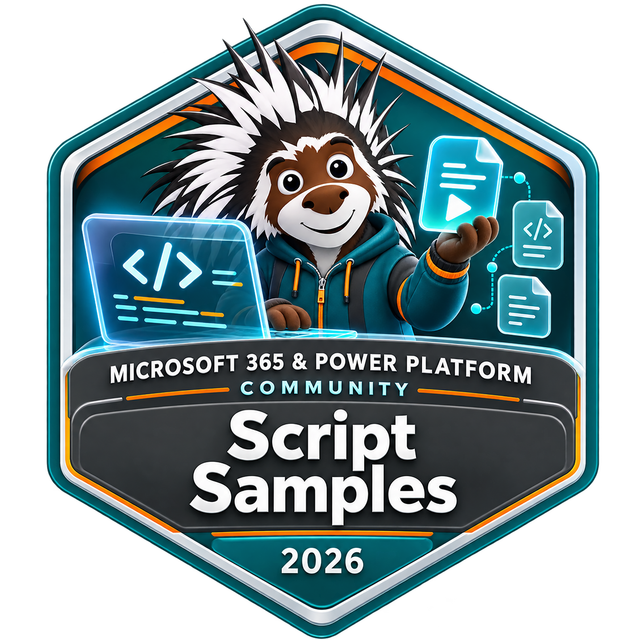

# Your script belongs here

A script you use every week could save someone hours. Community Script Samples is a place to share real-world solutions for Microsoft 365 and Power Platform, whether you are contributing for the first time or have been here for years.

**[Create your first sample](preparing-a-submission.md)** | [Improve an existing sample](how-can-i-contribute.md) | [Browse the gallery](../index.md)

## Three steps to share what works

1. **Make a starting point.** Fork and clone the [repository](https://github.com/pnp/script-samples), then run `New-Sample.ps1` from its root in PowerShell 7. It creates the folder, README, metadata, and tabs for your chosen tools.
2. **Add your scenario.** Paste in your tested script, explain permissions and the expected result, finish the metadata, and replace the preview image.
3. **Open a pull request.** Tell us what the sample does and how you tested it. Maintainers will help with questions and finishing touches.

Follow the [step-by-step preparation guide](preparing-a-submission.md) for a copyable command and a short checklist, then [submit your pull request](submitting-pull-requests.md).

## Use the tools you know

The generator supports PnP PowerShell, CLI for Microsoft 365 using PowerShell or Bash, Microsoft Graph PowerShell, SharePoint Online Management Shell, Azure CLI, Power Apps PowerShell, and Teams PowerShell. A sample can offer several implementations.

Working with another tool? [Tell us about your scenario](https://github.com/pnp/script-samples/issues/new). We welcome useful scripts beyond this list.

## Share a sample. Earn your badge.

Every sample contributor is eligible for the Script Samples contributor badge after their first accepted sample. [Opt in to the recognition program](https://pnp.github.io/recognitionprogram/); badges are issued in batches. [Learn how recognition works](recognition.md).

Your name and GitHub account help people discover your work. Share the published sample with your team, write about the problem it solves, or [request a community demo slot](https://aka.ms/community/request/demo).

## Start small, or get a hand

Fix a typo, explain a permission, test an update, or add another tool to a sample. [See more ways to contribute](how-can-i-contribute.md).

New to GitHub? [Sharing is caring](https://pnp.github.io/sharing-is-caring/) offers friendly, hands-on sessions. You can also [open an issue](https://github.com/pnp/script-samples/issues/new) before starting a larger idea to get feedback and avoid duplicate work.

[Community calls](https://aka.ms/community/calls) are open to everyone. Come to learn, ask questions, or share what you have built.

## Be part of a welcoming community

This project follows the [Microsoft Open Source Code of Conduct](https://opensource.microsoft.com/codeofconduct/). See the [FAQ](https://opensource.microsoft.com/codeofconduct/faq/) for details.

Contributors and maintainers volunteer their time. Be kind, allow time for review, and ask when something is unclear. Interested in helping others contribute? Read the [maintainers guidance](maintainers-guidance.md).

