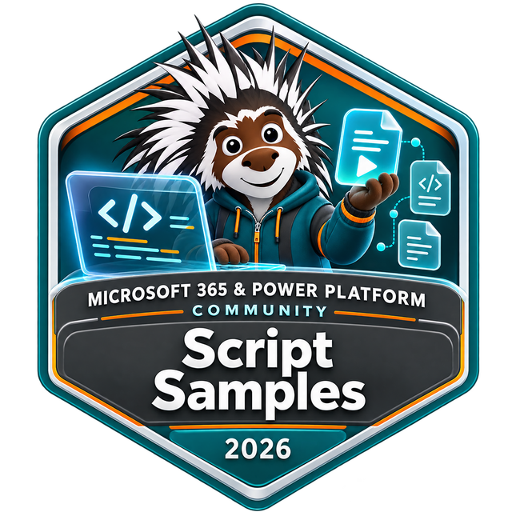

# Share your first script sample

Start with a useful scenario and a script you have tested. The generator takes care of the starting structure; you add the knowledge that makes the script useful to someone else.

> [!TIP]
> You do not need to build the website or know Astro or DocFX to contribute a script. If something is unclear, open your pull request and ask. Maintainers can help with finishing touches.

## 1. Get a local copy

You need a GitHub account, Git, an editor such as [Visual Studio Code](https://code.visualstudio.com/), and [PowerShell 7](https://learn.microsoft.com/powershell/scripting/install/installing-powershell).

[Fork the repository](https://github.com/pnp/script-samples/fork), clone **your fork**, and open PowerShell at the repository root:

```powershell
git clone https://github.com/YOUR-GITHUB-HANDLE/script-samples.git
Set-Location .\script-samples
git switch -c add-site-report
```

Replace `YOUR-GITHUB-HANDLE` with your account. The root is the folder containing `New-Sample.ps1` and `scripts`. New to this workflow? See [submitting a pull request](submitting-pull-requests.md) or try a [Sharing is caring session](https://pnp.github.io/sharing-is-caring/).

## 2. Generate a starting point

Run this from the repository root, replacing the scenario, your name, and your GitHub handle:

```powershell
.\New-Sample.ps1 -ScriptFolderName "spo-get-site-report" `
    -ScriptTitle "Report SharePoint sites" `
    -ScriptShortDescription "Export a SharePoint site inventory." `
    -ScriptTool PnPPowerShell `
    -AuthorFullName "Your name" `
    -GitHubId "your-github-handle"
```

Choose a **new, unused folder name**. The generator creates a new sample; it does not safely update an existing one. To improve an existing sample, edit that sample directly instead.

Use a descriptive lowercase folder name with hyphens and a workload prefix, such as `spo-get-site-report` or `graph-export-teams`. Avoid spaces, dots, and unnecessary words such as `sample` or `script`.

### Choose the tools you actually support

| `-ScriptTool` value | Generated code tab |
|---------------------|--------------------|
| `PnPPowerShell` | PnP PowerShell |
| `CliForMicrosoft365` | CLI for Microsoft 365 using PowerShell |
| `CliForMicrosoft365Bash` | CLI for Microsoft 365 using Bash |
| `MicrosoftGraphPowerShell` | Microsoft Graph PowerShell |
| `SPOManagementShell` | SharePoint Online Management Shell |
| `AzureCli` | Azure CLI |
| `PowerAppsPowerShell` | Power Apps PowerShell |
| `MicrosoftTeamsPowerShell` | Microsoft Teams PowerShell |

For several implementations, pass a comma-separated list:

```powershell
-ScriptTool PnPPowerShell,CliForMicrosoft365
```

This is an argument to the full generator command above, not a command to run on its own. Use explicit tool names for the implementations you plan to provide. `-ScriptTool All` creates all eight supported tabs; remove any you do not implement.

### What the generator does for you

It copies `scripts/_template-script-submission` into your new sample folder and:

- Creates `README.md`, `assets/sample.json`, and placeholder images.
- Fills in the title, summary, folder identity, dates, author name, GitHub account, and GitHub picture URL.
- Adds the code tabs, reference links, and metadata for the selected tools.
- Sets the sample's view-tracking image on the README's final line.

It does **not** write or execute your script, choose the correct product/scenario tags, verify permissions, or replace the example tool versions with versions you have tested.

## 3. Finish these three files

```text
scripts/
  spo-get-site-report/
    README.md
    assets/
      sample.json
      preview.png
      example.png  (optional README screenshot)
```

### README.md: explain the task, then show the script

- Describe the problem, expected result, required tools, and permissions.
- Replace `<your script>` in each tool tab with a complete, tested implementation. Remove unused tabs and template text.
- Use safe example values rather than credentials, usernames, tenant addresses, or private IDs.
- Put a clear warning **before the code** if the script changes permissions, deletes data, or performs another destructive action. Describe the affected data and any recovery limitations.
- Add an optional screenshot of the result. Remove the template's `example.png` reference if you do not need it.
- Credit all authors and keep the disclaimer near the bottom.

Keep the generated tab headings and shared documentation includes. If editing a tab manually, use a fenced code block with its language:

````markdown
# [PnP PowerShell](#tab/pnpps)

```powershell
# Replace this comment with your tested script.
```

[!INCLUDE [More about PnP PowerShell](../../docs/includes/MORE-PNPPS.md)]
````

### assets/sample.json: help people find the sample

Keep the existing JSON array containing one sample record.

- Use the folder name as `name`, and keep `title` and `shortDescription` consistent with the README.
- Keep **only the relevant products and categories**; the template starts with a broad list. Use `Microsoft Copilot` for that product.
- Add useful command names and topics to `tags`.
- Replace the generated example tool versions in `metadata` with the versions you tested.
- Verify the author names, GitHub accounts, picture URLs, sample URL, and preview URL/alt text.
- Preserve `creationDateTime` when updating an existing sample, and update `updateDateTime` for the change.

### assets/preview.png: show what someone will get

Replace the placeholder with a readable image representing your scenario. It does not have to be elaborate: a clear result or product-focused graphic helps readers decide whether the sample is relevant. Remove personal and tenant information before sharing screenshots.

The gallery preview is required; a separate screenshot in the README is optional.

## 4. Check it before sharing

- [ ] Each selected tool tab contains a tested script, with prerequisites and permissions explained.
- [ ] Destructive actions have a clear impact warning before the script.
- [ ] No credentials, tenant-specific details, or template placeholders remain.
- [ ] Metadata describes this sample, not every product or category in the template.
- [ ] The preview exists, and links, author attribution, and tested tool versions are correct.
- [ ] The disclaimer remains, and the README ends with the tracking image.

For `scripts/spo-get-site-report/README.md`, the final line must be:

```html

```

Keep any existing accessibility attributes. Replace the sample folder in the URL with your own repository-relative sample directory, using `/` separators. This image measures views; it does not run the script.

## 5. Open a pull request and earn recognition

[Submit your pull request](submitting-pull-requests.md) with a short description of the scenario and how you tested it. Keep the sample, its images, and related guidance together in one focused change.

[](https://pnp.github.io/recognitionprogram/)

Every sample contributor is eligible for the Script Samples contributor badge after their first accepted sample. [Opt in to the recognition program](https://pnp.github.io/recognitionprogram/); badges are issued in batches. [See how to share your work and request a community demo](recognition.md).

## Prefer not to run the generator?

Copy the [submission template](https://github.com/pnp/script-samples/tree/main/scripts/_template-script-submission) into a new folder under `scripts`. Rename `assets/template.sample.json` to `assets/sample.json`, fill in all placeholders, keep only the tool tabs you implement, and complete the same checklist above.

For guided editing in VS Code, install [CodeTour](https://marketplace.visualstudio.com/items?itemName=vsls-contrib.codetour) and open the repository's contribution tour.

[Browse the gallery](../index.md) | [Other ways to contribute](how-can-i-contribute.md) | [Get friendly GitHub help](https://pnp.github.io/sharing-is-caring/)


