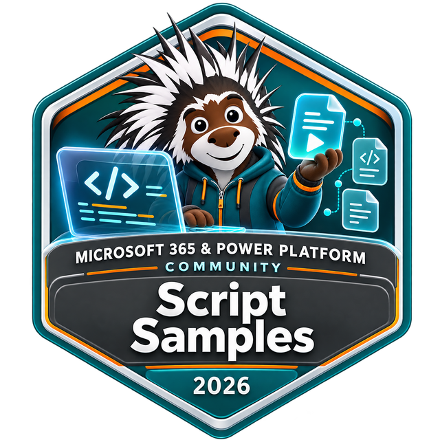

# Your contribution deserves recognition

Every useful script, improvement, and shared lesson helps someone else. Thank you for making Community Script Samples better.

## Earn your Script Samples contributor badge

The Script Samples contributor badge is for every sample contributor, including first-time contributors. You do not need a minimum number of samples beyond your first accepted sample.

1. **Share a sample.** Follow the [preparation guide](preparing-a-submission.md) and submit a pull request.
2. **Keep your attribution accurate.** Include your name and GitHub account in the README and `assets/sample.json`, alongside any coauthors.
3. **Opt in after your sample is accepted.** Follow the [community recognition program](https://pnp.github.io/recognitionprogram/) instructions so the team can recognize your contribution.
4. **Watch for your badge.** Issuance is processed in batches and can take a few weeks. Follow the program's instructions for claiming and sharing the credential.

The badge artwork shown here illustrates the recognition; displaying it is not a substitute for claiming your issued credential. Use your issued badge's share link on your profile, blog, or social posts.

## Help others discover your work

When your sample appears in the [gallery](../index.md), share its gallery URL and credit the authors. A useful post explains:

- The task or problem the sample solves.
- The product and tool used.
- A practical result, screenshot, or lesson learned, with sensitive information removed.
- A link inviting people to try it, give feedback, or contribute an improvement.

Maintainers may also highlight samples through community channels such as LinkedIn, Bluesky, Discord, and X. Promotion depends on the community schedule; publication is not a promise of an immediate post.

## Demo it on a community call

[Community calls](https://aka.ms/community/calls) are open to everyone. [Request a demo slot](https://aka.ms/community/request/demo) to show your scenario, walk through the script, and share what you learned. You do not need to be an experienced speaker.

## Keep the learning going

Help another contributor, test a sample with a newer tool version, or turn feedback into a small improvement. [Explore ways to contribute](how-can-i-contribute.md), or get hands-on GitHub support through [Sharing is caring](https://pnp.github.io/sharing-is-caring/).

[Contribute a sample](preparing-a-submission.md) | [Browse the gallery](../index.md) | [Community home](https://aka.ms/community/home)

