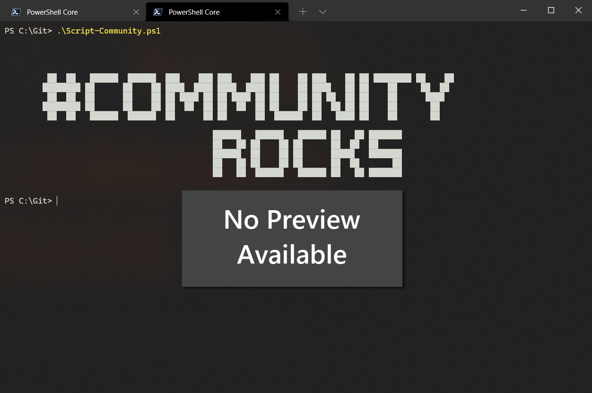

# <title>

> [!Note]
> This is a submission helper template. See the [preparing a submission guide](../../docs/contributing/preparing-a-submission.md) for the required sample structure.

## Summary

Lorem ipsum dolor sit amet, consectetuer adipiscing elit. Maecenas porttitor congue massa. Fusce posuere, magna sed pulvinar ultricies, purus lectus malesuada libero, sit amet commodo magna eros quis urna.



Lorem ipsum dolor sit amet, consectetuer adipiscing elit. Maecenas porttitor congue massa. Fusce posuere, magna sed pulvinar ultricies, purus lectus malesuada libero, sit amet commodo magna eros quis urna.Nunc viverra imperdiet enim. Fusce est. Vivamus a tellus.Pellentesque habitant morbi tristique senectus et netus et malesuada fames ac turpis egestas. Proin pharetra nonummy pede. Mauris et orci.Aenean nec lorem. In porttitor. Donec laoreet nonummy augue.


# [PnP PowerShell](#tab/pnpps)

```powershell

<your script>

```
[!INCLUDE [More about PnP PowerShell](../../docs/includes/MORE-PNPPS.md)]

# [CLI for Microsoft 365 using PowerShell](#tab/cli-m365-ps)

```powershell

<your script>

```
[!INCLUDE [More about CLI for Microsoft 365](../../docs/includes/MORE-CLIM365.md)]

# [CLI for Microsoft 365 using Bash](#tab/cli-m365-bash)

```bash

<your script>

```
[!INCLUDE [More about CLI for Microsoft 365](../../docs/includes/MORE-CLIM365.md)]

# [Microsoft Graph PowerShell](#tab/graphps)

```powershell

<your script>

```
[!INCLUDE [More about Microsoft Graph PowerShell SDK](../../docs/includes/MORE-GRAPHSDK.md)]

# [SPO Management Shell](#tab/spoms-ps)

```powershell

<your script>

```
[!INCLUDE [More about SPO Management Shell](../../docs/includes/MORE-SPOMS.md)]

# [Azure CLI](#tab/azure-cli)

```powershell

<your script>

```
[!INCLUDE [More about Azure CLI](../../docs/includes/MORE-AZURECLI.md)]

# [Power Apps PowerShell](#tab/powerapps-ps)
```powershell

<your script>

```
[!INCLUDE [More about Power Apps PowerShell](../../docs/includes/MORE-POWERAPPS.md)]

# [MicrosoftTeams PowerShell](#tab/teamsps)

```powershell

<your script>

```
[!INCLUDE [More about Microsoft Teams PowerShell](../../docs/includes/MORE-TEAMSPS.md)]

***


## Source Credit

Sample first appeared on [https://pnp.github.io/cli-microsoft365/sample-scripts/spo/add-app-catalog/](https://pnp.github.io/cli-microsoft365/sample-scripts/spo/add-app-catalog/)

## Contributors

| Author(s) |
|-----------|
| <-you-> |


[!INCLUDE [DISCLAIMER](../../docs/includes/DISCLAIMER.md)]
