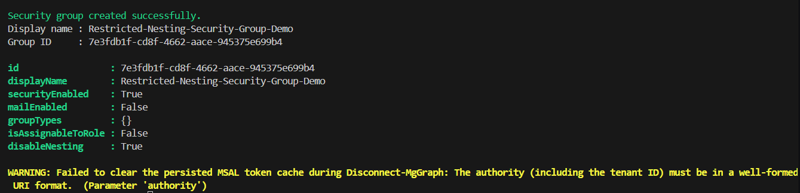

# Restricting Group Nesting in Microsoft Entra ID Using Graph API


## Summary

Managing group memberships in Microsoft Entra ID is critical for maintaining security and compliance. By default, both users and groups can be added to security groups, which may introduce complexity and risks.

In September 2026, a new preview enhancement introduced a group setting that allows administrators to define whether a security group can accept another group as a member, configurable through Microsoft Graph. By configuring the appropriate setting through Microsoft Graph, administrators can. This provides a more predictable and manageable security model.



By default, the script has only registered Microsoft Graph and SharePoint Online Microsoft AAD apps (with their respective appId property). Feel free to add any other API listed [here](https://learn.microsoft.com/troubleshoot/azure/active-directory/verify-first-party-apps-sign-in#application-ids-for-commonly-used-microsoft-applications) in the `AadApis` class!


# [CLI for Microsoft 365 using PowerShell](#tab/cli-m365-ps)

```powershell

# User Input
$api = "Microsoft Graph" # Or "SharePoint"
$permission = "Sites.Read.All" # Can be "Read" if seeking more permissions

# Connect to Microsoft 365
if ($(m365 status) -match "Logged Out") {
  m365 login
}

# Configure the CLI to output as JSON on each execution
$m365output = m365 cli config get --key output
if ($m365output -notmatch "json") {
    m365 cli config set --key output --value json
}

# Get CLI commands JSON output converted as objects
function Get-CLIValue {
    [cmdletbinding()]
    param(
        [parameter(Mandatory = $true, ValueFromPipeline = $true)]
        $input
    )
    
    $output = $input | ConvertFrom-Json
    if ($null -ne $output.error) {
        throw $output.error
    }
    return $output
}

# Dedicated class to store Azure AD (AAD) Enterprise Microsoft Apps as valid param inputs 
class AadApis : System.Management.Automation.IValidateSetValuesGenerator {
    [String[]] GetValidValues() {
        $Global:aadApis = @{
            "SharePoint" = "00000003-0000-0ff1-ce00-000000000000"
            "Microsoft Graph" = "00000003-0000-0000-c000-000000000000"
        }

        return ($Global:aadApis).Keys
    }
}

# Method to get delegated or application permissions from a registered AAD MS App, based on name

function Get-AADPermission {
    [cmdletbinding()]
    param(
        [parameter(Mandatory)]
        [ValidateSet([AadApis], IgnoreCase = $false)]
        $ApiName,
        [parameter(Mandatory)]
        $PermissionName,
        [parameter(Mandatory = $false)]
        [Switch]$Delegated,
        [parameter(Mandatory = $false)]
        [Switch]$Application
    )

    try {
        $sp = m365 aad sp get --appId ($Global:aadApis)[$ApiName] | Get-CLIValue

        if ($Delegated) {
            $permissionsInfo = $sp.oauth2PermissionScopes | Where-Object { $_.value -match $PermissionName }
        }
        elseif ($Application) {
            $permissionsInfo = $sp.appRoles | Where-Object { $_.value -match $PermissionName }
        }
        else {
            throw "Please define if seeked permission is a delegated (-Scope) or an application (-Role) one"
        }

        if ($permissionsInfo) {
            Write-Host "AAD app info:"
            Write-Host ($sp | Select-Object id, appId, displayName | Format-List | Out-String)
            Write-Host "-----------"
            Write-Host "Permissions info:"

            foreach ($perm in $permissionsInfo) {
                Write-Host ($perm | Format-List | Out-String)
            }
        }
        else {
            $permissionType = (&{If($Delegated -eq $true) {"Delegated"} Else {"Application"}})
            
            Write-Warning "No $($permissionType) permission named [$($PermissionName)] found for $($ApiName) App"
        }
    }
    catch {
        Write-Error $_.Exception
    }
}

# Run the command
Get-AADPermission -ApiName $api -PermissionName $permission -Application

```
[!INCLUDE [More about CLI for Microsoft 365](../../docfx/includes/MORE-CLIM365.md)]


# [Microsoft Graph PowerShell](#tab/graphps)

```powershell


###############################################################################

# DESCRIPTION
# Creates a Microsoft Entra Security Group using Microsoft Graph REST API
# with nested group membership restrictions enabled using the disableNesting
# property.
#
# AUTHOR
# Sujin Nelladath
#
# LINKEDIN
# https://www.linkedin.com/in/sujin-nelladath-8911968a/
#
#
# VERSION
# 1.0
#
# REQUIREMENTS
# - Microsoft Graph PowerShell Authentication Module
# - Group.ReadWrite.All
# - Group-NestingSupport.ReadWrite.All
#
# AUTHENTICATION
# Delegated Authentication using Connect-MgGraph
#
# API ENDPOINT
# POST https://graph.microsoft.com/beta/groups
#
# NOTES
# - Uses REST APIs through Invoke-MgGraphRequest.
# - Does not use New-MgGroup.
# - Creates the group with disableNesting enabled during creation.
# - Intended for Microsoft Graph Beta.
#
###############################################################################

# Install the authentication module if it is not already available
# Install-Module Microsoft.Graph.Authentication -Scope CurrentUser

$Scopes = @(
    "Group.ReadWrite.All"
    "Group-NestingSupport.ReadWrite.All"
)

Connect-MgGraph -Scopes $Scopes 

# Define the new security group
$GroupName        = "Restricted-Nesting-Security-Group"
$GroupDescription = "Security group that does not allow groups as members"
$MailNickname     = "RestrictedNestingSecurityGroup"

# All required and feature-specific properties are included at creation time
$GroupBody = @{
    displayName        = $GroupName
    description        = $GroupDescription
    mailEnabled        = $false
    mailNickname       = $MailNickname
    securityEnabled    = $true
    groupTypes         = @()
    isAssignableToRole = $false
    disableNesting     = $true
} | ConvertTo-Json -Depth 5

try {
    $NewGroup = Invoke-MgGraphRequest `
        -Method POST `
        -Uri "https://graph.microsoft.com/beta/groups" `
        -ContentType "application/json" `
        -Body $GroupBody

    Write-Host "Security group created successfully." -ForegroundColor Green
    Write-Host "Display name : $($NewGroup.displayName)"
    Write-Host "Group ID     : $($NewGroup.id)"

    # Request non-default properties explicitly for verification
    $Select = 'id,displayName,securityEnabled,mailEnabled,groupTypes,isAssignableToRole,disableNesting'
    $VerifyUri = "https://graph.microsoft.com/beta/groups/$($NewGroup.id)?`$select=$Select"
    $VerifiedGroup = Invoke-MgGraphRequest -Method GET -Uri $VerifyUri

  $GroupDetails = [PSCustomObject]@{
    Id                 = $VerifiedGroup.id
    DisplayName        = $VerifiedGroup.displayName
    SecurityEnabled    = $VerifiedGroup.securityEnabled
    MailEnabled        = $VerifiedGroup.mailEnabled
    GroupTypes         = ($VerifiedGroup.groupTypes -join ', ')
    IsAssignableToRole = $VerifiedGroup.isAssignableToRole
    DisableNesting     = $VerifiedGroup.disableNesting
}

$GroupDetails | Format-List
}
catch
{
    Write-Error "Group creation failed: $($_.Exception.Message)"
    if ($_.ErrorDetails.Message) 
    {
        Write-Error $_.ErrorDetails.Message
    }
}
finally 
{
    Disconnect-MgGraph | Out-Null
}


```
[!INCLUDE [More about Microsoft Graph PowerShell SDK](../../docfx/includes/MORE-GRAPHSDK.md)]
***


## Contributors

| Author(s)                                            |
|------------------------------------------------------|
| [Sujin Nelladath](https://github.com/nelladath) | (https://www.linkedin.com/in/sujin-nelladath-8911968a/)


[!INCLUDE [DISCLAIMER](../../docfx/includes/DISCLAIMER.md)]
