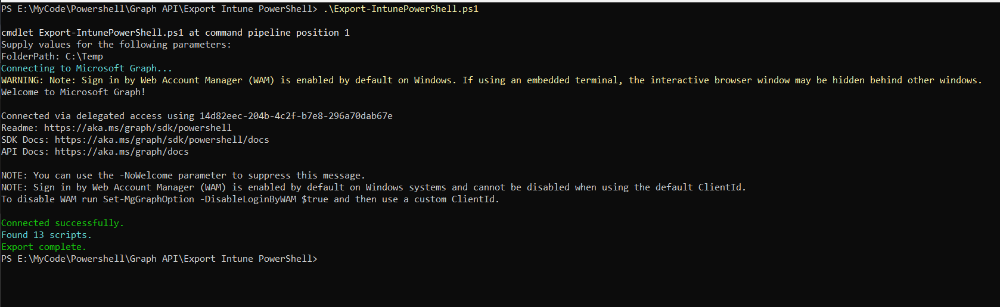

# Export Intune PowerShell scripts to local storage.

## Summary

Retrieves all or specific PowerShell scripts from Microsoft Intune via Graph API and saves them locally.
Designed for automation workflows, script auditing, and compliance tracking. The script connects with "DeviceManagementConfiguration.Read.All" and "DeviceManagementScripts.Read.All" permissions


By default, the script has only registered Microsoft Graph and SharePoint Online Microsoft AAD apps (with their respective appId property). Feel free to add any other API listed [here](https://learn.microsoft.com/troubleshoot/azure/active-directory/verify-first-party-apps-sign-in#application-ids-for-commonly-used-microsoft-applications) in the `AadApis` class!


# [CLI for Microsoft 365 using PowerShell](#tab/cli-m365-ps)

```powershell

# User Input
$api = "Microsoft Graph" # Or "SharePoint"
$permission = "Sites.Read.All" # Can be "Read" if seeking more permissions

# Connect to Microsoft 365
if ($(m365 status) -match "Logged Out") {
  m365 login
}

# Configure the CLI to output as JSON on each execution
$m365output = m365 cli config get --key output
if ($m365output -notmatch "json") {
    m365 cli config set --key output --value json
}

# Get CLI commands JSON output converted as objects
function Get-CLIValue {
    [cmdletbinding()]
    param(
        [parameter(Mandatory = $true, ValueFromPipeline = $true)]
        $input
    )
    
    $output = $input | ConvertFrom-Json
    if ($null -ne $output.error) {
        throw $output.error
    }
    return $output
}

# Dedicated class to store Azure AD (AAD) Enterprise Microsoft Apps as valid param inputs 
class AadApis : System.Management.Automation.IValidateSetValuesGenerator {
    [String[]] GetValidValues() {
        $Global:aadApis = @{
            "SharePoint" = "00000003-0000-0ff1-ce00-000000000000"
            "Microsoft Graph" = "00000003-0000-0000-c000-000000000000"
        }

        return ($Global:aadApis).Keys
    }
}

# Method to get delegated or application permissions from a registered AAD MS App, based on name
function Get-AADPermission {
    [cmdletbinding()]
    param(
        [parameter(Mandatory)]
        [ValidateSet([AadApis], IgnoreCase = $false)]
        $ApiName,
        [parameter(Mandatory)]
        $PermissionName,
        [parameter(Mandatory = $false)]
        [Switch]$Delegated,
        [parameter(Mandatory = $false)]
        [Switch]$Application
    )

    try {
        $sp = m365 aad sp get --appId ($Global:aadApis)[$ApiName] | Get-CLIValue

        if ($Delegated) {
            $permissionsInfo = $sp.oauth2PermissionScopes | Where-Object { $_.value -match $PermissionName }
        }
        elseif ($Application) {
            $permissionsInfo = $sp.appRoles | Where-Object { $_.value -match $PermissionName }
        }
        else {
            throw "Please define if seeked permission is a delegated (-Scope) or an application (-Role) one"
        }

        if ($permissionsInfo) {
            Write-Host "AAD app info:"
            Write-Host ($sp | Select-Object id, appId, displayName | Format-List | Out-String)
            Write-Host "-----------"
            Write-Host "Permissions info:"

            foreach ($perm in $permissionsInfo) {
                Write-Host ($perm | Format-List | Out-String)
            }
        }
        else {
            $permissionType = (&{If($Delegated -eq $true) {"Delegated"} Else {"Application"}})
            
            Write-Warning "No $($permissionType) permission named [$($PermissionName)] found for $($ApiName) App"
        }
    }
    catch {
        Write-Error $_.Exception
    }
}

# Run the command
Get-AADPermission -ApiName $api -PermissionName $permission -Application

```
[!INCLUDE [More about CLI for Microsoft 365](../../docfx/includes/MORE-CLIM365.md)]


# [Microsoft Graph PowerShell](#tab/graphps)

```powershell

<#
.SYNOPSIS
Export Intune PowerShell scripts to local storage.

.DESCRIPTION
Retrieves all or specific PowerShell scripts from Microsoft Intune via Graph API and saves them locally.
Designed for automation workflows, script auditing, and compliance tracking.

.AUTHOR
Sujin Nelladath — Microsoft Graph MVP

.PARAMETER FolderPath
Destination folder for exported scripts.

.PARAMETER FileName
Optional: Specific script filename to export.

.EXAMPLE
Export all scripts:
.\Export-IntuneScripts.ps1 -FolderPath "C:\Intune\Scripts"

.EXAMPLE
Export a single script:
.\Export-IntuneScripts.ps1 -FolderPath "C:\Intune\Scripts" -FileName "IntuneScript.ps1"
#>

Param(
    [Parameter(Mandatory)] [string]$FolderPath,
    [Parameter()] [string]$FileName
)

#Connect to Microsoft Graph
Write-Host "Connecting to Microsoft Graph..." -ForegroundColor Cyan

try 

{
    Connect-MgGraph -Scopes "DeviceManagementConfiguration.Read.All","DeviceManagementScripts.Read.All"
    
    Write-Host "Connected successfully." -ForegroundColor Green
} 

catch

{
    Write-Error "Connection failed: $_"
    exit
}


#Check Destination Folder

if (!(Test-Path $FolderPath)) 

{
    New-Item -Path $FolderPath -ItemType Directory -Force | Out-Null
    Write-Host "Created folder: $FolderPath" -ForegroundColor Yellow
}


#Export Function
function Export-IntuneScript 

{
    param (
        [Parameter(Mandatory)] $ScriptObject,
        [Parameter(Mandatory)] $DestinationFolder
    )

    $apiVersion = "beta"
    $baseUri = "https://graph.microsoft.com/$apiVersion"
    $scriptDetails = Invoke-MgGraphRequest -Uri "$baseUri/deviceManagement/deviceManagementScripts/$($ScriptObject.id)" -Method GET
    $decodedContent = [System.Text.Encoding]::ASCII.GetString([System.Convert]::FromBase64String($scriptDetails.scriptContent))
    $outputPath = Join-Path $DestinationFolder $ScriptObject.fileName

    $decodedContent | Out-File -Encoding ASCII -FilePath $outputPath
    Add-Content -Path $outputPath -Value "`n# Exported by Sujin Nelladath — Microsoft Graph MVP"
}

#Retrieve and Export Scripts
$graphApiVersion = "beta"
$baseUri = "https://graph.microsoft.com/$graphApiVersion"
$scriptList = (Invoke-MgGraphRequest -Uri "$baseUri/deviceManagement/deviceManagementScripts" -Method GET).value
$totalScripts = $scriptList.Count
Write-Host "Found $totalScripts scripts." -ForegroundColor Cyan

$counter = 1
foreach ($script in $scriptList)

 {
    $progress = ($counter * 100 / $totalScripts)
    Write-Progress -Activity "Exporting $($script.fileName)" -Status "$counter of $totalScripts" -PercentComplete $progress

    if ($FileName)
     {
        if ($script.fileName -eq $FileName)

         {
            Export-IntuneScript -ScriptObject $script -DestinationFolder $FolderPath
         }
    }
    
    else
    
         {
            Export-IntuneScript -ScriptObject $script -DestinationFolder $FolderPath
         }

    $counter++
}
Write-Host "Export complete." -ForegroundColor Green
#endregion

```
[!INCLUDE [More about Microsoft Graph PowerShell SDK](../../docfx/includes/MORE-GRAPHSDK.md)]
***


## Contributors

| Author(s)                                            |
|------------------------------------------------------|
| [Sujin Nelladath](https://github.com/nelladath) | (https://www.linkedin.com/in/sujin-nelladath-8911968a/)


[!INCLUDE [DISCLAIMER](../../docfx/includes/DISCLAIMER.md)]
