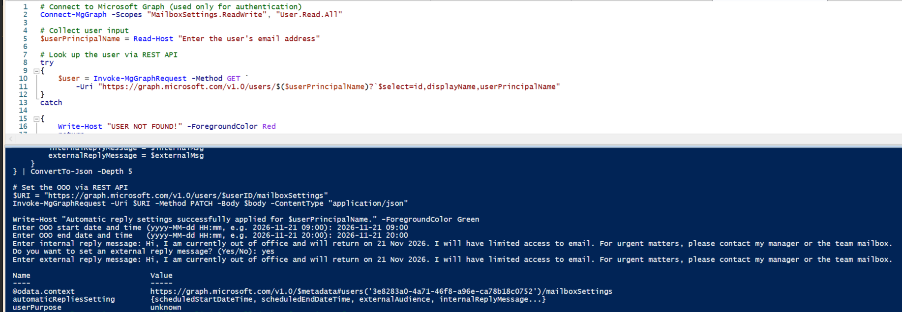

# Set Out of Office for a user's mailbox using the Microsoft Graph API

## Summary

Admins often need to configure Out of Office for users who are on leave, leaving the organisation, or unavailable (for example, during offboarding). This script lets an admin set it without logging in to the user's mailbox. The script connects with "MailboxSettings.ReadWrite" and "User.Read.All" permission



By default, the script has only registered Microsoft Graph and SharePoint Online Microsoft AAD apps (with their respective appId property). Feel free to add any other API listed [here](https://learn.microsoft.com/troubleshoot/azure/active-directory/verify-first-party-apps-sign-in#application-ids-for-commonly-used-microsoft-applications) in the `AadApis` class!


```powershell

# Connect to Microsoft Graph (used only for authentication)
Connect-MgGraph -Scopes "MailboxSettings.ReadWrite", "User.Read.All"

# Collect user input
$userPrincipalName = Read-Host "Enter the user's email address"

# Look up the user via REST API
try 
{
    $user = Invoke-MgGraphRequest -Method GET `
        -Uri "https://graph.microsoft.com/v1.0/users/$($userPrincipalName)?`$select=id,displayName,userPrincipalName"
}
catch 

{
    Write-Host "USER NOT FOUND!" -ForegroundColor Red
    return
}
$userID = $user.id

# Out of Office time inputs
$startTime = Read-Host "Enter OOO start date and time (yyyy-MM-dd HH:mm, e.g. 2026-11-21 09:00)"
$endTime   = Read-Host "Enter OOO end date and time   (yyyy-MM-dd HH:mm, e.g. 2026-11-21 20:00)"

$format  = "yyyy-MM-dd HH:mm"
$culture = [System.Globalization.CultureInfo]::InvariantCulture
$start = [datetime]::MinValue
$end   = [datetime]::MinValue

if (-not ([datetime]::TryParseExact($startTime, $format, $culture, 'None', [ref]$start) -and
          [datetime]::TryParseExact($endTime,   $format, $culture, 'None', [ref]$end))) {
    Write-Host "Invalid date format. Use $format." -ForegroundColor Red
    return
}
if ($end -le $start)
{
    Write-Host "End time must be after start time." -ForegroundColor Red
    return
}
if ($end -le (Get-Date))

{
    Write-Host "End time must be in the future." -ForegroundColor Red
    return
}

$startTimeInIso = $start.ToString("yyyy-MM-ddTHH:mm:ss")
$endTimeInIso   = $end.ToString("yyyy-MM-ddTHH:mm:ss")

# Out of Office messages
$internalMsg = Read-Host "Enter internal reply message"
$setExternal = Read-Host "Do you want to set an external reply message? (Yes/No)"

$externalMsg = ""
$externalAudience = "none"
if ($setExternal -eq "Yes") 
{
    $externalMsg = Read-Host "Enter external reply message"
    $externalAudience = "all"
}

# Body
$body = @{
    automaticRepliesSetting = @{
        status                = "scheduled"
        externalAudience      = $externalAudience
        scheduledStartDateTime = @{
            dateTime = $startTimeInIso
            timeZone = "India Standard Time"
        }
        scheduledEndDateTime = @{
            dateTime = $endTimeInIso
            timeZone = "India Standard Time"
        }
        internalReplyMessage = $internalMsg
        externalReplyMessage = $externalMsg
    }
} | ConvertTo-Json -Depth 5

# Set the OOO via REST API
$URI = "https://graph.microsoft.com/v1.0/users/$userID/mailboxSettings"
Invoke-MgGraphRequest -Uri $URI -Method PATCH -Body $body -ContentType "application/json"

Write-Host "Automatic reply settings successfully applied for $userPrincipalName." -ForegroundColor Green

```
[!INCLUDE [More about Microsoft Graph PowerShell SDK](../../docfx/includes/MORE-GRAPHSDK.md)]
***


## Contributors

| Author(s)                                            |
|------------------------------------------------------|
| [Sujin Nelladath](https://github.com/nelladath) | (https://www.linkedin.com/in/sujin-nelladath-8911968a/)


[!INCLUDE [DISCLAIMER](../../docfx/includes/DISCLAIMER.md)]
