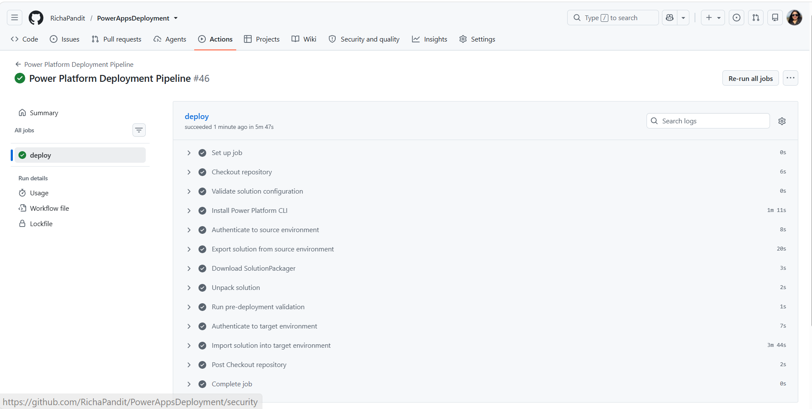

# Deploy Power Platform Solutions with Pre-Deployment Validation

## Summary

This sample demonstrates how to deploy an unmanaged Power Platform solution from a source environment to a target environment using GitHub Actions, PowerShell, Power Platform CLI and SolutionPackager.

Before the solution is imported, the pipeline unpacks the exported solution and validates selected components against configurable naming conventions. Validation errors stop the workflow and prevent deployment to the target environment. Warnings are reported without blocking deployment.



The sample validates naming conventions for:

- Model-driven apps
- Dataverse tables
- Cloud flows
- Canvas app screens

The default naming conventions can be replaced with conventions appropriate to your organisation.

## Solution flow

The GitHub Actions workflow performs the following operations:

1. Validates the pipeline configuration.
2. Installs Power Platform CLI.
3. Authenticates to the source Power Platform environment using a service principal.
4. Exports an unmanaged solution.
5. Downloads SolutionPackager from the Microsoft.CrmSdk.CoreTools NuGet package.
6. Unpacks the exported solution.
7. Runs the custom PowerShell validation.
8. Blocks deployment if validation errors are found.
9. Authenticates to the target environment.
10. Imports and publishes the solution when validation succeeds.

```text
Source environment
        |
        v
Export unmanaged solution
        |
        v
Unpack solution
        |
        v
Run naming validation
        |
        +---- Errors found ----> Stop deployment
        |
        v
Validation passed
        |
        v
Import into target environment
```

## Included files

| File | Purpose |
|------|---------|
| `deploy-solution.yml` | GitHub Actions workflow that orchestrates export, validation and deployment |
| `scripts/ExportSolution.ps1` | Exports an unmanaged solution using Power Platform CLI |
| `scripts/validate-solution.ps1` | Validates solution components and returns a failing exit code when errors are found |
| `assets/sample.json` | Gallery metadata for the PnP Script Samples site |
| `assets/example.png` | Example image displayed on this page |
| `assets/preview.png` | Preview image used by the sample gallery |

## Prerequisites

Before using the sample, ensure that:

- The source and target Power Platform environments are available.
- A Microsoft Entra application registration has been created.
- The application user has the required permissions in both Power Platform environments.
- GitHub Actions is enabled in the repository.
- A solution with the configured unique name exists in the source environment.
- The repository contains the workflow and PowerShell scripts using the structure shown below.
- Any connection references required by solution-aware cloud flows should be included in the source solution so that the solution can be successfully imported into the target environment.

```text
.github/
└── workflows/
    └── deploy-solution.yml

scripts/
├── ExportSolution.ps1
└── validate-solution.ps1
```

> [!IMPORTANT]
> In this PnP sample, `deploy-solution.yml` is stored at the sample root so that it does not run as a workflow in the PnP repository. When using the sample in your own repository, copy it to `.github/workflows/deploy-solution.yml`.

## GitHub configuration

Configure the following repository variable under:

**Settings > Secrets and variables > Actions > Variables**

| Variable | Description |
|----------|-------------|
| `PP_SOLUTION_NAME` | Unique name of the Power Platform solution to export and deploy |

Configure the following repository secrets under:

**Settings > Secrets and variables > Actions > Secrets**

| Secret | Description |
|--------|-------------|
| `PP_ENV_URL` | URL of the source Power Platform environment |
| `PP_ENV_TARGET_URL` | URL of the target Power Platform environment |
| `PP_APP_ID` | Application ID of the Microsoft Entra application registration |
| `PP_CLIENT_SECRET` | Client secret used by the application registration |
| `PP_TENANT_ID` | Microsoft Entra tenant ID |

Do not store credentials, environment URLs or tenant-specific identifiers directly in the workflow or PowerShell scripts.

## Validation rules

The sample includes default naming validation rules implemented as regular-expression parameters in `validate-solution.ps1`.

These rules are sample best-practice conventions rather than Microsoft-required naming standards. The parameters can be overridden if your organisation uses different naming conventions.

| Component | Value inspected | Default pattern | Example passing value |
|-----------|-----------------|-----------------|-----------------------|
| Model-driven app | App display name | `^[A-Za-z][A-Za-z0-9]*[-_][A-Za-z0-9 _-]+$` | `Sales_Order Management` |
| Dataverse table | Table logical name | `^[a-z][a-z0-9]*_[A-Za-z0-9_]+$` | `contoso_customer` |
| Cloud flow | Flow display name or exported workflow name | `^[A-Za-z][A-Za-z0-9]*[-_][A-Za-z0-9_-]+$` | `Operations-ProcessOrder` |
| Canvas app screen | `.pa.yaml` screen filename | `^[A-Za-z][A-Za-z0-9_]*$` | `CustomerDetails` |

For Dataverse tables, the validator inspects the table folder created under `Entities` by SolutionPackager instead of recursively evaluating XML files belonging to forms, views, ribbons and other table components.

For cloud flows, the validator uses the workflow display name when available. If the exported workflow metadata does not expose the display name, the validator derives the readable name from the SolutionPackager workflow filename by removing the trailing workflow GUID.

For canvas apps, internal `.pa.yaml` files whose names begin with `_` are excluded from screen-name validation.

The patterns can also be overridden when invoking the validation script directly.

For example:

```powershell
./scripts/validate-solution.ps1 `
    -solutionPath ".\UnpackedSolution" `
    -solutionZip ".\Solutions\ContosoCore.zip" `
    -solutionPackagerPath ".\tools\CoreTools\content\bin\coretools\SolutionPackager.exe" `
    -ModelDrivenAppNamePattern '^app_[A-Z].*' `
    -TableLogicalNamePattern '^contoso_[a-z0-9_]+$' `
    -FlowNamePattern '^flow_[A-Z].*' `
    -CanvasScreenNamePattern '^screen[A-Z].*' `
    -ReportPath ".\validation-report.json"
```

## Validation behaviour

The validation script records two finding severities:

- **Warning**: Provides visibility but does not prevent deployment. For example, an optional component folder isn't present.
- **Error**: Causes the validation script to return exit code `1`, which stops the GitHub Actions workflow before the target import occurs.
- **Successful validation**: Returns exit code `0`, allowing the deployment pipeline to continue.

When `ReportPath` is supplied, the findings are also written to a JSON report.

## Using the sample

1. Copy `deploy-solution.yml` to `.github/workflows/deploy-solution.yml` in your own repository.
2. Copy the two PowerShell files to the repository's `scripts` directory.
3. Configure the required GitHub Actions variable and secrets.
4. Update the regular-expression parameters if your naming standards differ from the defaults.
5. Open the repository's **Actions** page.
6. Select **Power Platform Deployment Pipeline**.
7. Run the workflow manually, or push to the configured branch.

The workflow imports the solution into the target environment only when the validation step succeeds.

## Important considerations

- The supplied workflow exports and imports an unmanaged solution.
- Test the workflow in non-production environments before adapting it for production use.
- Review the permissions assigned to the service principal and use only the permissions required by the deployment process.
- Review the import options before applying the workflow to an existing production ALM process.
- The naming conventions in this sample are examples and should be adapted to your organisational standards.

# [Power Apps PowerShell](#tab/powerapps-ps)

The solution uses two PowerShell scripts together with the included GitHub Actions workflow.

Download or copy the following files from this sample:

- `scripts/ExportSolution.ps1`
- `scripts/validate-solution.ps1`
- `deploy-solution.yml`

[!INCLUDE [More about Power Apps PowerShell](../../docfx/includes/MORE-POWERAPPS.md)]

***

## Contributors

| Author(s) |
|-----------|
| Richa Pandit |

[!INCLUDE [DISCLAIMER](../../docfx/includes/DISCLAIMER.md)]
