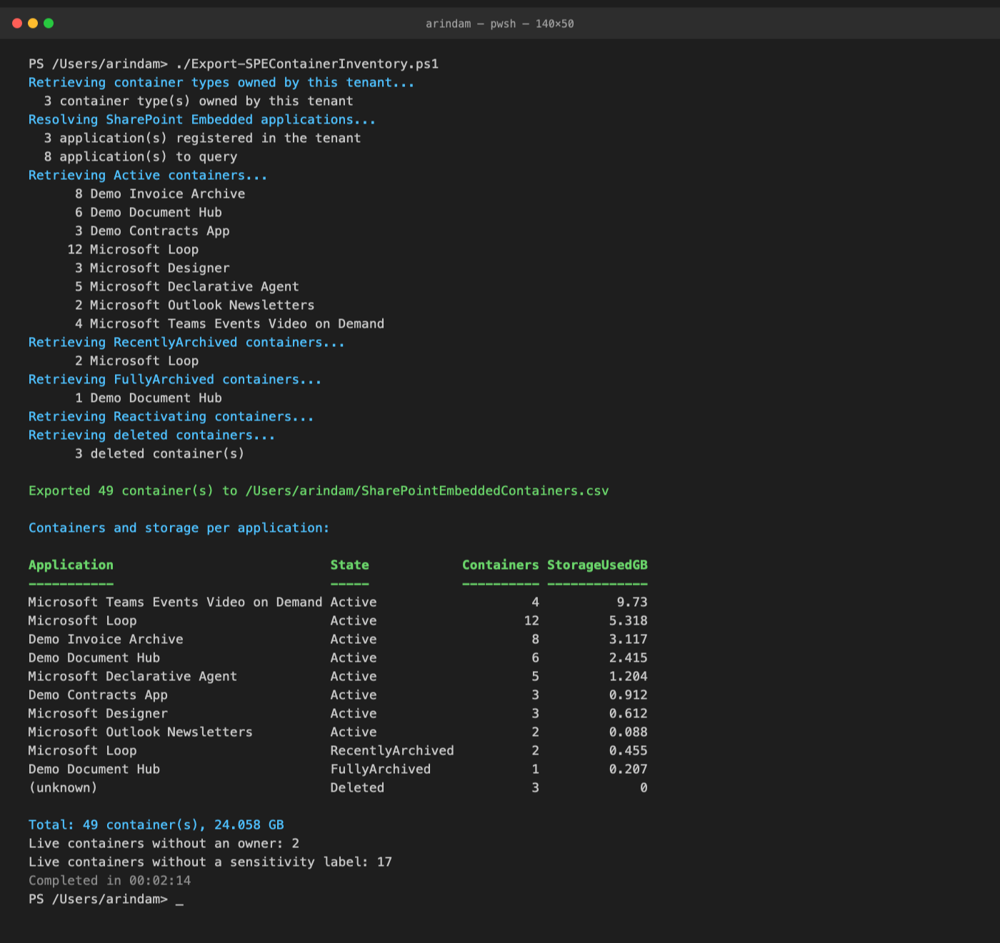

# Export SharePoint Embedded container inventory to CSV

## Summary

SharePoint Embedded stores app data in containers that do not appear in the site list of the SharePoint admin center. Admins can only see them per application on the Active containers page, with no export and no combined view. As more first-party apps (Loop, Designer, declarative agents) and third-party apps adopt SharePoint Embedded, a tenant accumulates storage that is hard to audit for size, labelling or ownership.

This script builds a single inventory of every SharePoint Embedded container in the tenant and exports it to CSV. It covers:

- Active containers, with owning application, site URL, description, status, sensitivity label, owners, storage used and creation date
- Archived containers, flagged with their archive state (recently archived, fully archived or reactivating)
- Deleted containers still sitting in the deleted container collection (purged after 93 days)
- Container types owned by the tenant, so developer tenants also see billing classification and Azure subscription ID per type

It finishes with a console summary of container count and storage used per application and state, the tenant total, and the number of containers that have no owners or no sensitivity label, so you can spot the apps that are growing fastest and the containers that need governance attention.



**Minimum Steps To Success**

* Update the admin site URL and the Entra app registration (client) ID used for PnP PowerShell.
* Optionally change the CSV output path. By default the file is written to your home folder.
* Optionally add your own or vendor application ids to the known application table, or set `$owningApplicationIds` to inventory specific applications only.
* Run the script with an account that holds the SharePoint Embedded Administrator or Global Administrator role.

### Prerequisites

- PowerShell 7.4 or later and PnP PowerShell 3.4.1 or later. The script works on the released 3.4.1 and takes advantage of newer cmdlets when they are present.
- An Entra app registration for PnP PowerShell. See [Register an Entra ID application to use with PnP PowerShell](https://pnp.github.io/powershell/articles/registerapplication.html). The default delegated permissions from that article are sufficient; the script signs in as you and never needs application permissions.
- The account running the script must be a SharePoint Embedded Administrator or Global Administrator. Without the role every container query fails, and the script stops with a clear error rather than reporting an empty tenant.

### How applications are discovered

The container cmdlets list containers per owning application, so the script first builds the list of applications to query:

1. The applications registered in the tenant. Newer PnP PowerShell builds expose this as `Get-PnPContainerApplication`; on 3.4.1 the script makes the same SharePoint client call directly through the PnP connection. Microsoft Loop is not returned by this call, which is why step 2 is always merged in.
2. The `$knownApplications` table in the script, pre-filled with the Microsoft applications that use SharePoint Embedded: Loop (which also holds Copilot Pages and Copilot Notebooks), Designer, declarative agents, Outlook newsletters and Teams events video on demand. Add your own or vendor applications here. Their ids are shown in the SharePoint admin center under SharePoint Embedded, Active containers, Application filter, or by `Get-SPOApplication` in the SharePoint Online Management Shell.
3. Applications that own a container type in this tenant, from `Get-PnPContainerType`.

Set `$owningApplicationIds` to query only specific applications, for example Loop alone.

### Performance and limits

- Containers are read in pages of 200 per application and archive state, following the paging token until the end, so large tenants are fully covered on every PnP PowerShell version.
- The list call only returns a subset of properties. With `$resolveContainerDetails = $true` (the default) the script fetches each container by identity to add the application name, container type id, site URL, description, ownership type, principal owner, owners, creator and archive details, which costs one extra call per container. Set it to `$false` for a fast run that still gives counts, storage, labels, owner counts and dates per application. PnP PowerShell retries automatically when the service throttles. The elapsed time is printed at the end.
- Container archiving uses Microsoft 365 Archive, which is in preview for SharePoint Embedded. Tenants without it simply return no archived containers.

> [!Note]
> `Get-PnPContainerType` only returns container types that this tenant owns. A tenant that merely consumes SharePoint Embedded apps (for example Loop or a vendor app) will see zero container types but will still see all of its containers, because the inventory is driven by owning applications, which every tenant can query.

### CSV columns

| Column | Meaning |
|--------|---------|
| State | Active, RecentlyArchived, FullyArchived, Reactivating or Deleted. When details are read, the service's own archive status of the container is used |
| OwningApplicationName, OwningApplicationId | The SharePoint Embedded application that owns the container. Empty for deleted containers, which expose no application details |
| ContainerTypeId | The container type the container belongs to, read from the container itself when details are read |
| ContainerTypeName, BillingClassification, AzureSubscriptionId | Filled only when this tenant owns the container type |
| ContainerId, ContainerName, Description, ContainerSiteUrl | Container identity. The site URL is what Purview tools ask for |
| Status | Status reported by the service |
| OwnershipType, PrincipalOwner | Tenant-owned, user-owned or group-owned, and the principal whose lifecycle governs the container, when details are read |
| SensitivityLabel | Display name of the label applied to the container, empty if none |
| Owners, OwnersCount, IsOwnerless | Owner principals, their count, and True when a live container has no owner |
| StorageUsedInBytes, StorageUsedInMB | Storage consumed |
| CreatedBy, CreatedOn, LastArchivedOn, ArchivedBy, DeletedOn | Who and when, as returned by the service, formatted for Excel |

# [PnP PowerShell](#tab/pnpps)

```powershell

#Requires -Version 7.4
#Requires -Modules @{ ModuleName = 'PnP.PowerShell'; ModuleVersion = '3.4.1' }

$adminUrl                = "https://contoso-admin.sharepoint.com"
$clientId                = "00000000-0000-0000-0000-000000000000"   # Entra app registration used for PnP PowerShell
$outputPath              = Join-Path -Path $HOME -ChildPath "SharePointEmbeddedContainers.csv"
$owningApplicationIds    = @()      # Optional: inventory only these owning application ids. Empty = discover applications (see below)
$resolveContainerDetails = $true    # One extra call per container for application name, site URL, description and owners. Set to $false for a fast run
$includeArchived         = $true
$includeDeleted          = $true

# Microsoft applications that store content in SharePoint Embedded, with their owning application ids (from the Get-SPOContainer docs).
# Add your own or vendor applications here as id = name, or pass their ids in $owningApplicationIds.
$knownApplications = [ordered]@{
    "a187e399-0c36-4b98-8f04-1edc167a0996" = "Microsoft Loop"
    "5e2795e3-ce8c-4cfb-b302-35fe5cd01597" = "Microsoft Designer"
    "e8be65d6-d430-4289-a665-51bf2a194bda" = "Microsoft Declarative Agent"
    "155d75a8-799c-4ad4-ae3f-0084ccced5fa" = "Microsoft Outlook Newsletters"
    "7fc21101-d09b-4343-8eb3-21187e0431a4" = "Microsoft Teams Events Video on Demand"
}

$previousErrorActionPreference = $ErrorActionPreference
$ErrorActionPreference = "Stop"

# Archive states to query. NotArchived is the active set. Order is also used for sorting the CSV and the summary.
$stateOrder = [ordered]@{ Active = 0; RecentlyArchived = 1; FullyArchived = 2; Reactivating = 3; Deleted = 4 }
$archiveStatusByState = [ordered]@{ Active = "NotArchived"; RecentlyArchived = "RecentlyArchived"; FullyArchived = "FullyArchived"; Reactivating = "Reactivating" }

function ConvertTo-GuidText {
    [CmdletBinding()]
    param($Value)

    # Unset CSOM guids come back as Guid.Empty; export those as blank
    if ($null -eq $Value) { return "" }
    $text = [string]$Value
    if ($text -eq [guid]::Empty.ToString()) { return "" }
    return $text
}

function ConvertTo-ExcelDate {
    [CmdletBinding()]
    param([Nullable[datetime]]$Value)

    # CSOM returns DateTime.MinValue for dates that are not set
    if ($null -eq $Value -or $Value -eq [datetime]::MinValue) { return "" }
    return $Value.ToString("yyyy-MM-dd HH:mm:ss")
}

function Get-OwningApplication {
    # Returns an ordered map of owning application id to name for the applications to inventory.
    [CmdletBinding()]
    param(
        [AllowEmptyCollection()] [string[]]$RequestedIds,
        [Parameter(Mandatory)] [System.Collections.IDictionary]$KnownApplications,
        [AllowEmptyCollection()] [object[]]$ContainerTypes
    )

    $apps = [ordered]@{}

    if ($RequestedIds.Count -gt 0) {
        foreach ($id in $RequestedIds) {
            try { $key = ([guid]$id).ToString() }
            catch { throw "'$id' in `$owningApplicationIds is not a valid application id (GUID)." }
            $apps[$key] = if ($KnownApplications.Contains($key)) { $KnownApplications[$key] } else { "" }
        }
        return $apps
    }

    # 1. Applications registered in the tenant. Get-PnPContainerApplication exists in PnP PowerShell nightly builds and releases
    #    after 3.4.1. On 3.4.1 the same CSOM call is made directly through the connection's context. Microsoft Loop is not
    #    returned by this call, which is why the known application table below is always merged in as well.
    $registered = @()
    try {
        if (Get-Command -Name Get-PnPContainerApplication -ErrorAction SilentlyContinue) {
            $registered = @(Get-PnPContainerApplication)
        }
        else {
            $context = Get-PnPContext
            $tenant = [Microsoft.Online.SharePoint.TenantAdministration.Tenant]::new($context)
            $result = $tenant.GetSPOSyntexApplications()
            $context.ExecuteQuery()
            $registered = if ($result.PSObject.Properties["Value"]) { @($result.Value) } else { @($result) }
        }
        foreach ($app in $registered) {
            $apps[([guid]$app.OwningApplicationId).ToString()] = [string]$app.OwningApplicationName
        }
        Write-Host ("  {0} application(s) registered in the tenant" -f $registered.Count)
    }
    catch {
        Write-Warning "Could not list the registered applications, continuing with the known application table: $($_.Exception.Message)"
    }

    # 2. Known Microsoft and custom applications
    foreach ($key in $KnownApplications.Keys) {
        if (-not $apps.Contains($key)) { $apps[$key] = $KnownApplications[$key] }
    }

    # 3. Applications that own a container type in this tenant
    foreach ($ct in $ContainerTypes) {
        $key = ([guid]$ct.OwningAppId).ToString()
        if (-not $apps.Contains($key)) { $apps[$key] = [string]$ct.DisplayName }
    }

    return $apps
}

function Get-ContainerList {
    # Enumerates the containers of one application in one archive state, following the paging token until the end.
    # Works the same on PnP PowerShell 3.4.1 and on nightly builds: with -Paged the cmdlet writes one page plus a token message.
    [CmdletBinding()]
    param(
        [Parameter(Mandatory)] [guid]$OwningApplicationId,
        [Parameter(Mandatory)] [string]$ArchiveStatus
    )

    $pagingToken = $null
    $seenTokens = [System.Collections.Generic.HashSet[string]]::new()
    do {
        $pageParams = @{ OwningApplicationId = $OwningApplicationId; ArchiveStatus = $ArchiveStatus; Paged = $true }
        if ($pagingToken) { $pageParams.PagingToken = $pagingToken }
        $pagingToken = $null

        foreach ($item in @(Get-PnPContainer @pageParams)) {
            if ($item -is [string]) {
                # "Retrieve remaining containers with token: <token>" or "End of containers view."
                if ($item -match "token:\s*(.+)$") { $pagingToken = $Matches[1].Trim() }
            }
            else {
                $item
            }
        }
    } while ($pagingToken -and $seenTokens.Add($pagingToken))
}

function New-ContainerRow {
    [CmdletBinding()]
    param(
        [Parameter(Mandatory)] [string]$State,   # the query that returned the container; overridden by the service's ArchiveStatus when details are read
        [Parameter(Mandatory)] $Summary,          # list object: ContainerId, ContainerName, Status, SensitivityLabel, OwnersCount, StorageUsed, CreatedOn
        [string]$OwningApplicationId,             # known from the enumeration loop
        [string]$OwningApplicationName,           # from the application map, may be empty
        $Detail,                                  # Get-PnPContainer -Identity result (SPContainerProperties), or $null
        $ContainerType,                           # container type owned by this tenant, or $null
        [Nullable[datetime]]$DeletedOn
    )

    $bytes = 0
    if ($Detail -and $Detail.StorageUsed) { $bytes = [long]$Detail.StorageUsed }
    elseif ($Summary.StorageUsed)         { $bytes = [long]$Summary.StorageUsed }

    $effectiveState = $State
    if ($Detail -and $Detail.ArchiveStatus -and [string]$Detail.ArchiveStatus -ne "NotArchived") { $effectiveState = [string]$Detail.ArchiveStatus }

    $appName = if ($Detail -and $Detail.OwningApplicationName) { $Detail.OwningApplicationName } else { $OwningApplicationName }
    $owners = if ($Detail -and $Detail.Owners) { @($Detail.Owners) -join "; " } else { "" }
    $isOwnerless = if ($null -ne $Summary.OwnersCount) { [int]$Summary.OwnersCount -eq 0 } else { "" }

    [PSCustomObject]@{
        State                 = $effectiveState
        OwningApplicationName = $appName
        OwningApplicationId   = ConvertTo-GuidText $OwningApplicationId
        ContainerTypeId       = if ($Detail) { ConvertTo-GuidText $Detail.ContainerTypeId } elseif ($ContainerType) { ConvertTo-GuidText $ContainerType.ContainerTypeId } else { "" }
        ContainerTypeName     = if ($ContainerType) { $ContainerType.DisplayName } else { "" }
        BillingClassification = if ($ContainerType) { [string]$ContainerType.SPContainerTypeBillingClassification } else { "" }
        AzureSubscriptionId   = if ($ContainerType) { ConvertTo-GuidText $ContainerType.AzureSubscriptionId } else { "" }
        ContainerId           = $Summary.ContainerId
        ContainerName         = $Summary.ContainerName
        Description           = if ($Detail) { $Detail.Description } else { "" }
        ContainerSiteUrl      = if ($Detail) { $Detail.ContainerSiteUrl } else { "" }
        Status                = $Summary.Status
        OwnershipType         = if ($Detail) { $Detail.OwnershipType } else { "" }
        PrincipalOwner        = if ($Detail) { $Detail.PrincipalOwnerIdentifier } else { "" }
        SensitivityLabel      = $Summary.SensitivityLabel
        Owners                = $owners
        OwnersCount           = $Summary.OwnersCount
        IsOwnerless           = $isOwnerless
        StorageUsedInBytes    = $bytes
        StorageUsedInMB       = [math]::Round($bytes / 1MB, 2)
        CreatedBy             = if ($Detail) { $Detail.CreatedBy } else { "" }
        CreatedOn             = ConvertTo-ExcelDate $Summary.CreatedOn
        LastArchivedOn        = if ($Detail) { ConvertTo-ExcelDate $Detail.LastArchivedDateTime } else { "" }
        ArchivedBy            = if ($Detail) { $Detail.ArchivedBy } else { "" }
        DeletedOn             = ConvertTo-ExcelDate $DeletedOn
    }
}

function Get-ContainerDetail {
    [CmdletBinding()]
    param([Parameter(Mandatory)] [string]$ContainerId)

    try {
        return Get-PnPContainer -Identity $ContainerId
    }
    catch {
        Write-Warning "Could not read details for container $ContainerId : $($_.Exception.Message)"
        return $null
    }
}

function Read-ContainerSet {
    # Turns the containers of one application and state into inventory rows, optionally resolving details per container.
    # Containers already seen (by id) are skipped so a container cannot be exported twice.
    [CmdletBinding()]
    param(
        [Parameter(Mandatory)] [string]$State,
        [AllowEmptyCollection()] [object[]]$Containers,
        [Parameter(Mandatory)] [string]$OwningApplicationId,
        [AllowEmptyString()] [string]$OwningApplicationName,
        [Parameter(Mandatory)] [hashtable]$TypeLookup,   # container types owned by this tenant, keyed by ContainerTypeId and by OwningAppId
        [Parameter(Mandatory)] [System.Collections.Generic.HashSet[string]]$SeenContainerIds,
        [bool]$ResolveDetails
    )

    $ctByApp = if ($TypeLookup.ContainsKey($OwningApplicationId)) { $TypeLookup[$OwningApplicationId] } else { $null }
    $label = if ($OwningApplicationName) { $OwningApplicationName } else { $OwningApplicationId }

    $i = 0
    foreach ($container in $Containers) {
        $i++
        if (-not $SeenContainerIds.Add([string]$container.ContainerId)) { continue }

        $detail = $null
        if ($ResolveDetails) {
            $status = "{0} of {1}: {2}" -f $i, $Containers.Count, $container.ContainerName
            Write-Progress -Activity "Reading $State containers of $label" -Status $status -PercentComplete (($i / $Containers.Count) * 100)
            $detail = Get-ContainerDetail -ContainerId $container.ContainerId
        }
        # The container carries its own ContainerTypeId; prefer that exact match over the owning application
        $ct = $ctByApp
        if ($detail -and $detail.ContainerTypeId) {
            $typeKey = ([guid]$detail.ContainerTypeId).ToString()
            if ($TypeLookup.ContainsKey($typeKey)) { $ct = $TypeLookup[$typeKey] }
        }
        New-ContainerRow -State $State -Summary $container -OwningApplicationId $OwningApplicationId -OwningApplicationName $OwningApplicationName -Detail $detail -ContainerType $ct
    }
    if ($ResolveDetails) { Write-Progress -Activity "Reading $State containers of $label" -Completed }
}

$stopwatch = [System.Diagnostics.Stopwatch]::StartNew()
$connected = $false
$inventory = [System.Collections.Generic.List[object]]::new()
$seenContainerIds = [System.Collections.Generic.HashSet[string]]::new([System.StringComparer]::OrdinalIgnoreCase)

try {
    try {
        Connect-PnPOnline -Url $adminUrl -ClientId $clientId -Interactive
        $connected = $true
    }
    catch {
        throw "Could not connect to ${adminUrl}: $($_.Exception.Message) (Check the admin URL and client ID, and sign in with a SharePoint Embedded Administrator or Global Administrator account.)"
    }

    # 1. Container types owned by this tenant (empty on a pure consuming tenant)
    Write-Host "Retrieving container types owned by this tenant..." -ForegroundColor Cyan
    $containerTypes = @()
    try {
        $containerTypes = @(Get-PnPContainerType)
    }
    catch {
        Write-Warning "Could not list container types: $($_.Exception.Message)"
    }
    # A tenant that only consumes apps owns no container types and gets an empty list here, which is normal.
    # Each owning application has exactly one container type, so the lookup is keyed both ways.
    $typeLookup = @{}
    foreach ($ct in $containerTypes) {
        $typeLookup[([guid]$ct.ContainerTypeId).ToString()] = $ct
        $typeLookup[([guid]$ct.OwningAppId).ToString()] = $ct
    }
    Write-Host ("  {0} container type(s) owned by this tenant" -f $containerTypes.Count)

    # 2. Applications to inventory
    Write-Host "Resolving SharePoint Embedded applications..." -ForegroundColor Cyan
    $applications = Get-OwningApplication -RequestedIds $owningApplicationIds -KnownApplications $knownApplications -ContainerTypes $containerTypes
    Write-Host ("  {0} application(s) to query" -f $applications.Count)

    # 3. Active and archived containers, per application and archive state. An application that is not registered in the
    #    tenant may fail to list; that is only a warning. If every application fails, the account almost certainly lacks the role.
    $states = if ($includeArchived) { @($archiveStatusByState.Keys) } else { @("Active") }
    foreach ($state in $states) {
        Write-Host ("Retrieving {0} containers..." -f $state) -ForegroundColor Cyan
        $succeeded = 0
        $failed = 0
        foreach ($appId in @($applications.Keys)) {
            $appName  = $applications[$appId]
            $appLabel = if ($appName) { $appName } else { $appId }
            $containers = @()
            try {
                $containers = @(Get-ContainerList -OwningApplicationId $appId -ArchiveStatus $archiveStatusByState[$state])
                $succeeded++
            }
            catch {
                $failed++
                Write-Warning ("Could not list {0} containers of {1}: {2}" -f $state, $appLabel, $_.Exception.Message)
                continue
            }
            if ($containers.Count -gt 0) {
                Write-Host ("  {0,5} {1}" -f $containers.Count, $appLabel)
                $inventory.AddRange([object[]]@(Read-ContainerSet -State $state -Containers $containers -OwningApplicationId $appId -OwningApplicationName $appName -TypeLookup $typeLookup -SeenContainerIds $seenContainerIds -ResolveDetails $resolveContainerDetails))
            }
        }
        if ($state -eq "Active" -and $succeeded -eq 0 -and $failed -gt 0) {
            throw "Could not list containers for any application. If the warnings above are access errors, the account needs the SharePoint Embedded Administrator or Global Administrator role."
        }
    }

    # 4. Deleted containers still in the deleted container collection. They carry no application id, so they cannot be filtered by app.
    if ($includeDeleted -and $owningApplicationIds.Count -gt 0) {
        Write-Host "Skipping deleted containers because an owning application filter is set." -ForegroundColor Yellow
    }
    elseif ($includeDeleted) {
        Write-Host "Retrieving deleted containers..." -ForegroundColor Cyan
        $deletedContainers = @()
        try {
            $deletedContainers = @(Get-PnPDeletedContainer)
        }
        catch {
            Write-Warning "Could not list deleted containers: $($_.Exception.Message)"
        }
        Write-Host ("  {0,5} deleted container(s)" -f $deletedContainers.Count)

        foreach ($container in $deletedContainers) {
            if (-not $seenContainerIds.Add([string]$container.ContainerId)) { continue }
            # Deleted containers expose only id, name and dates; details cannot be read until restored.
            $summary = [PSCustomObject]@{
                ContainerId      = $container.ContainerId
                ContainerName    = $container.ContainerName
                Status           = "Deleted"
                SensitivityLabel = ""
                OwnersCount      = $null
                StorageUsed      = 0
                CreatedOn        = $container.CreatedOn
            }
            $inventory.Add((New-ContainerRow -State "Deleted" -Summary $summary -DeletedOn $container.DeletedOn))
        }
    }

    # 5. Export and summarise
    if ($inventory.Count -eq 0) {
        Write-Host "No SharePoint Embedded containers were found for the queried applications." -ForegroundColor Yellow
    }
    else {
        $outputDir = Split-Path -Parent $outputPath
        if ($outputDir -and -not (Test-Path -Path $outputDir)) {
            New-Item -ItemType Directory -Path $outputDir -Force | Out-Null
        }
        $inventory |
            Sort-Object @{ Expression = { $stateOrder[$_.State] } }, OwningApplicationName, @{ Expression = "StorageUsedInBytes"; Descending = $true } |
            Export-Csv -Path $outputPath -NoTypeInformation -Encoding utf8BOM
        Write-Host ""
        Write-Host ("Exported {0} container(s) to {1}" -f $inventory.Count, $outputPath) -ForegroundColor Green

        Write-Host ""
        Write-Host "Containers and storage per application:" -ForegroundColor Cyan
        $inventory |
            Group-Object OwningApplicationName, OwningApplicationId, State |
            ForEach-Object {
                $groupBytes = ($_.Group | Measure-Object -Property StorageUsedInBytes -Sum).Sum
                $first = $_.Group[0]
                [PSCustomObject]@{
                    Application   = if ($first.OwningApplicationName) { $first.OwningApplicationName } elseif ($first.OwningApplicationId) { $first.OwningApplicationId } else { "(unknown)" }
                    State         = $first.State
                    Containers    = $_.Count
                    StorageUsedGB = [math]::Round($groupBytes / 1GB, 3)
                }
            } |
            Sort-Object @{ Expression = { $stateOrder[$_.State] } }, @{ Expression = "StorageUsedGB"; Descending = $true } |
            Format-Table -AutoSize |
            Out-Host

        $totalBytes = ($inventory | Measure-Object -Property StorageUsedInBytes -Sum).Sum
        $liveRows   = @($inventory | Where-Object { $_.State -ne "Deleted" })
        $ownerless  = @($liveRows | Where-Object { $_.IsOwnerless -eq $true }).Count
        $unlabelled = @($liveRows | Where-Object { -not $_.SensitivityLabel }).Count
        Write-Host ("Total: {0} container(s), {1} GB" -f $inventory.Count, [math]::Round($totalBytes / 1GB, 3)) -ForegroundColor Cyan
        Write-Host ("Live containers without an owner: {0}" -f $ownerless)
        Write-Host ("Live containers without a sensitivity label: {0}" -f $unlabelled)
    }
}
finally {
    if ($connected) { Disconnect-PnPOnline -ErrorAction SilentlyContinue }
    $ErrorActionPreference = $previousErrorActionPreference
    Write-Host ("Completed in {0:hh\:mm\:ss}" -f $stopwatch.Elapsed) -ForegroundColor DarkGray
}

```
[!INCLUDE [More about PnP PowerShell](../../docfx/includes/MORE-PNPPS.md)]
***

## Contributors

| Author(s) |
|-----------|
| [Arindam Choudhury](https://github.com/ari20089) |

[!INCLUDE [DISCLAIMER](../../docfx/includes/DISCLAIMER.md)]

