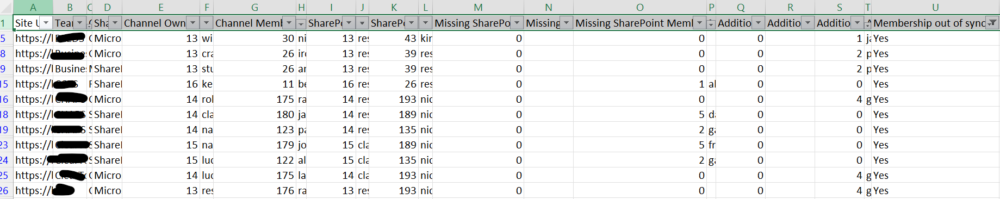

# Permission discrepancies between Teams and SharePoint sites 

## Summary

Permissions for shared channels should be managed from Teams and the channel itself, not by manually changing permissions on the underlying SharePoint site.

That said, the background synchronisation between Teams shared channels and SharePoint can occasionally fail. When that happens, users who are correctly listed as channel owners or members may still be unable to search, open, or work with the content stored in the connected SharePoint site.

This can happen while processing mass permission updates following a migration, e.g. more than 10k permission changes in one go.



### Prerequisites

- The script will take a list of sites from a csv file with the following columns: Team, Channel and SiteUrl

# [PnP PowerShell](#tab/pnpps)

```powershell
$dateTime = Get-Date -Format "dd-MM-yyyy_HHmm"

$invocation = (Get-Variable MyInvocation).Value
$directoryPath = Split-Path $invocation.MyCommand.Path
$logsPath = Join-Path $directoryPath "Logs"

if (-not (Test-Path $logsPath)) {
    New-Item -Path $logsPath -ItemType Directory -Force | Out-Null
}

$fileName = "ChannelsSharePointPermissions-$dateTime.csv"
$outputView = Join-Path $logsPath $fileName

$CertPassword = Read-Host "Please enter Certificate Password:" -AsSecureString

# Important: use the plain URL, not the HTML anchor copied from Teams/Outlook.
$TenantUrl = "https://contoso.sharepoint.com"
$TenantName = $TenantUrl.Split('/')[2].Split('.')[0]

$CertPath = "C:\Users\xx\ReshmeeCertPnP.pfx"
$csvSitesPath = Read-Host "Enter path to CSV file"
$clientId = "xxx"

$teamsChannelsCollection = @()

function Get-NormalisedUserIdentity {
    [CmdletBinding()]
    param(
        [Parameter(Mandatory, ValueFromPipeline)]
        $User
    )

    process {
        $identity = $null

        # Teams channel user properties
        if ($User.Email) {
            $identity = $User.Email
        }
        elseif ($User.Mail) {
            $identity = $User.Mail
        }
        elseif ($User.UserPrincipalName) {
            $identity = $User.UserPrincipalName
        }

        # SharePoint or Microsoft 365 group properties
        elseif ($User.LoginName) {
            $identity = $User.LoginName
        }

        if ([string]::IsNullOrEmpty($identity)) {
            return $null
        }

        # Convert a SharePoint claims login such as
        # i:0#.f|membership|user@domain.com
        # into user@domain.com
        if ($identity -match '\|') {
            $identity = ($identity -split '\|')[-1]
        }

        $identity.Trim().ToLowerInvariant()
    }
}

function Get-UserDisplayValue {
    [CmdletBinding()]
    param(
        [Parameter(Mandatory, ValueFromPipeline)]
        $User
    )

    process {
        $identity = Get-NormalisedUserIdentity -User $User

        if (-not [string]::IsNullOrEmpty($identity)) {
            return $identity
        }

        if ($User.DisplayName) {
            return $User.DisplayName
        }

        if ($User.Title) {
            return $User.Title
        }

        return "Unknown user"
    }
}

$sites = Import-Csv -Path $csvSitesPath |
    Where-Object { $_.Exclude -ne "Yes" }

$adminConnection = Connect-PnPOnline -ClientId $clientId -CertificatePath $CertPath -CertificatePassword $CertPassword -Url $TenantUrl -Tenant "$TenantName.onmicrosoft.com" -ValidateConnection -ReturnConnection

foreach ($site in $sites) {
    $siteUrl = $site.SiteUrl
    Write-Host "Checking Team '$($site.Team)', channel '$($site.Channel)'..."  -ForegroundColor Cyan
    try {
        # Channel membership is the source of truth.
        $owners = @(
            Get-PnPTeamsChannelUser `
                -Team $site.Team `
                -Channel $site.Channel `
                -Role Owner `
                -Connection $adminConnection `
                -ErrorAction Stop
        )

        $members = @(
            Get-PnPTeamsChannelUser `
                -Team $site.Team `
                -Channel $site.Channel `
                -Role Member `
                -Connection $adminConnection `
                -ErrorAction Stop
        )

        $siteChannel = Get-PnPTenantSite `
            -Detailed `
            -Identity $siteUrl `
            -Connection $adminConnection `
            -ErrorAction Stop

        $groupId = $siteChannel.GroupId

        $siteConnection = Connect-PnPOnline `
            -ClientId $clientId `
            -CertificatePath $CertPath `
            -CertificatePassword $CertPassword `
            -Url $siteUrl `
            -Tenant "$TenantName.onmicrosoft.com" `
            -ValidateConnection `
            -ReturnConnection

        $ownersGroup = Get-PnPGroup `
            -AssociatedOwnerGroup `
            -Connection $siteConnection `
            -ErrorAction Stop

        $membersGroup = Get-PnPGroup `
            -AssociatedMemberGroup `
            -Connection $siteConnection `
            -ErrorAction Stop

        # For shared/private channel sites, these SharePoint groups will normally
        # be used when the site is not backed by a Microsoft 365 group.
        $siteOwners = @(
            Get-PnPGroupMember `
                -Group $ownersGroup `
                -Connection $siteConnection `
                -ErrorAction Stop
        )

        $siteMembers = @(
            Get-PnPGroupMember `
                -Group $membersGroup `
                -Connection $siteConnection `
                -ErrorAction Stop
        )

        $siteMembershipSource = "SharePoint groups"

        # Retain support for group-connected sites in the input report.
        if (
            $null -ne $groupId -and
            $groupId -ne [System.Guid]::Empty
        ) {
            $siteOwners = @(
                Get-PnPMicrosoft365GroupOwner `
                    -Identity $groupId `
                    -Connection $siteConnection `
                    -ErrorAction Stop
            )

            $siteMembers = @(
                Get-PnPMicrosoft365GroupMember `
                    -Identity $groupId `
                    -Connection $siteConnection `
                    -ErrorAction Stop
            )

            $siteMembershipSource = "Microsoft 365 group"
        }

        # Build case-insensitive identity lookup sets.
        $siteOwnerIdentitySet = [System.Collections.Generic.HashSet[string]]::new(
            [System.StringComparer]::OrdinalIgnoreCase
        )

        $siteMemberIdentitySet = [System.Collections.Generic.HashSet[string]]::new(
            [System.StringComparer]::OrdinalIgnoreCase
        )

        # Build a combined set of everyone currently present in the channel.
        # Owners and members are combined to avoid incorrectly flagging a channel
        # owner who also appears in the SharePoint Members group.
        $channelIdentitySet = [System.Collections.Generic.HashSet[string]]::new(
            [System.StringComparer]::OrdinalIgnoreCase
        )

        $channelOwnerIdentitySet = [System.Collections.Generic.HashSet[string]]::new(
            [System.StringComparer]::OrdinalIgnoreCase
        )

        $channelMemberIdentitySet = [System.Collections.Generic.HashSet[string]]::new(
            [System.StringComparer]::OrdinalIgnoreCase
        )

        foreach ($channelOwner in $owners) {
            $identity = Get-NormalisedUserIdentity -User $channelOwner

            if (-not [string]::IsNullOrEmpty($identity)) {
                [void]$channelOwnerIdentitySet.Add($identity)
                [void]$channelIdentitySet.Add($identity)
            }
        }

        foreach ($channelMember in $members) {
            $identity = Get-NormalisedUserIdentity -User $channelMember

            if (-not [string]::IsNullOrEmpty($identity)) {
                [void]$channelMemberIdentitySet.Add($identity)
                [void]$channelIdentitySet.Add($identity)
            }
        }

        foreach ($siteOwner in $siteOwners) {
            $identity = Get-NormalisedUserIdentity -User $siteOwner

            if (-not [string]::IsNullOrEmpty($identity)) {
                [void]$siteOwnerIdentitySet.Add($identity)
            }
        }

        foreach ($siteMember in $siteMembers) {
            $identity = Get-NormalisedUserIdentity -User $siteMember

            if (-not [string]::IsNullOrEmpty($identity)) {
                [void]$siteMemberIdentitySet.Add($identity)
            }
        }

        # Identify users who exist in the channel but are missing from SharePoint.
        $missingOwners = @(
            foreach ($channelOwner in $owners) {
                $identity = Get-NormalisedUserIdentity -User $channelOwner

                if (
                    -not [string]::IsNullOrEmpty($identity) -and
                    -not $siteOwnerIdentitySet.Contains($identity)
                ) {
                    $channelOwner
                }
            }
        )

        $missingMembers = @(
            foreach ($channelMember in $members) {
                $identity = Get-NormalisedUserIdentity -User $channelMember

                if (
                    -not [string]::IsNullOrEmpty($identity) -and
                    -not $siteMemberIdentitySet.Contains($identity)
                ) {
                    $channelMember
                }
            }
        )
        
        # Identify SharePoint owners who no longer exist anywhere in the channel.
        $additionalSharePointOwners = @(
            foreach ($siteOwner in $siteOwners) {
                $identity = Get-NormalisedUserIdentity -User $siteOwner

                if (
                    -not [string]::IsNullOrEmpty($identity) -and
                    -not $channelIdentitySet.Contains($identity)
                ) {
                    $siteOwner
                }
            }
        )

        # Identify SharePoint members who no longer exist anywhere in the channel.
        $additionalSharePointMembers = @(
            foreach ($siteMember in $siteMembers) {
                $identity = Get-NormalisedUserIdentity -User $siteMember

                if (
                    -not [string]::IsNullOrEmpty($identity) -and
                    -not $channelIdentitySet.Contains($identity)
                ) {
                    $siteMember
                }
            }
        )

        $additionalSharePointOwnerValues = @(
            $additionalSharePointOwners |
                ForEach-Object {
                    Get-UserDisplayValue -User $_
                }
        )

        $additionalSharePointMemberValues = @(
            $additionalSharePointMembers |
                ForEach-Object {
                    Get-UserDisplayValue -User $_
                }
        )
        
        $missingOwnerValues = @(
            $missingOwners |
                ForEach-Object { Get-UserDisplayValue -User $_ }
        )

        $missingMemberValues = @(
            $missingMembers |
                ForEach-Object { Get-UserDisplayValue -User $_ }
        )

        $channelOwnerValues = @(
            $owners |
                ForEach-Object { Get-UserDisplayValue -User $_ }
        )

        $channelMemberValues = @(
            $members |
                ForEach-Object { Get-UserDisplayValue -User $_ }
        )

        $siteOwnerValues = @(
            $siteOwners |
                ForEach-Object { Get-UserDisplayValue -User $_ }
        )

        $siteMemberValues = @(
            $siteMembers |
                ForEach-Object { Get-UserDisplayValue -User $_ }
        )

        $outOfSync = if ($missingOwners.Count -gt 0 -or $missingMembers.Count -gt 0 -or $additionalSharePointOwners.Count -gt 0 -or $additionalSharePointMembers.Count -gt 0
        ) {
            "Yes"
        }
        else {
            "No"
        }

        $numberOutOfSync = $missingOwners.Count + $missingMembers.Count + $additionalSharePointOwners.Count + $additionalSharePointMembers.Count
        if ($outOfSync -eq "Yes") {
          Write-Warning (
            "Membership mismatch found for '$siteUrl'. " +
            "Missing SharePoint owners: $($missingOwners.Count); " +
            "Missing SharePoint members: $($missingMembers.Count); " +
            "Additional SharePoint owners: $($additionalSharePointOwners.Count); " +
            "Additional SharePoint members: $($additionalSharePointMembers.Count)"
            )
        }

        $exportView = [PSCustomObject]@{
            "Site URL"                       = $siteUrl
            "Teams"                          = $site.Team
            "Channel"                        = $site.Channel
            "SharePoint Membership Source"   = $siteMembershipSource

            "Channel Owners Count"            = $owners.Count
            "Channel Owners"                  = $channelOwnerValues -join ";"

            "Channel Members Count"           = $members.Count
            "Channel Members"                 = $channelMemberValues -join ";"

            "SharePoint Owners Count"         = $siteOwners.Count
            "SharePoint Owners"               = $siteOwnerValues -join ";"

            "SharePoint Members Count"        = $siteMembers.Count
            "SharePoint Members"              = $siteMemberValues -join ";"

            "Missing SharePoint Owners Count" = $missingOwners.Count
            "Missing SharePoint Owners"       = $missingOwnerValues -join ";"

            "Missing SharePoint Members Count" = $missingMembers.Count
            "Missing SharePoint Members"       = $missingMemberValues -join ";"

            "Additional SharePoint Owners Count" = $additionalSharePointOwners.Count
            "Additional SharePoint Owners"       = $additionalSharePointOwnerValues -join ";"

            "Additional SharePoint Members Count" = $additionalSharePointMembers.Count
            "Additional SharePoint Members"       = $additionalSharePointMemberValues -join ";"
            "Membership out of sync"          = $outOfSync
            "Membership Count out of sync"    = $numberOutOfSync
            "Status"                          = "Success"
            "Error"                           = $null
        }

        $teamsChannelsCollection += $exportView
    }
    catch {
        Write-Warning "Failed to process '$siteUrl': $($_.Exception.Message)"

        $teamsChannelsCollection += [PSCustomObject]@{
            "Site URL"                        = $siteUrl
            "Teams"                           = $site.Team
            "Channel"                         = $site.Channel
            "SharePoint Membership Source"    = $null
            "Channel Owners Count"             = $null
            "Channel Owners"                   = $null
            "Channel Members Count"            = $null
            "Channel Members"                  = $null
            "SharePoint Owners Count"          = $null
            "SharePoint Owners"                = $null
            "SharePoint Members Count"         = $null
            "SharePoint Members"               = $null
            "Missing SharePoint Owners Count"  = $null
            "Missing SharePoint Owners"        = $null
            "Missing SharePoint Members Count" = $null
            "Missing SharePoint Members"       = $null
            "Additional SharePoint Owners Count"  = $null
            "Additional SharePoint Owners"        = $null
            "Additional SharePoint Members Count" = $null
            "Additional SharePoint Members"       = $null
            "Membership out of sync"           = "Unknown"
            "Membership Count out of sync"     = $null
            "Status"                           = "Failed"
            "Error"                            = $_.Exception.Message
        }
    }
}

$teamsChannelsCollection |
    Sort-Object "Site URL" |
    Export-Csv `
        -Path $outputView `
        -Force `
        -NoTypeInformation `
        -Encoding UTF8

Write-Host "Report exported to: $outputView" -ForegroundColor Green
```

[!INCLUDE [More about PnP PowerShell](../../docfx/includes/MORE-PNPPS.md)]

***

## Source Credit

Sample first appeared on [Shared channels permissions synchronisation to SharePoint](https://reshmeeauckloo.com/posts/sharepoint-teams-permissions-synchronisation//)

## Contributors

| Author(s) |
|-----------|
| [Reshmee Auckloo](https://github.com/reshmee011) |


[!INCLUDE [DISCLAIMER](../../docfx/includes/DISCLAIMER.md)]

